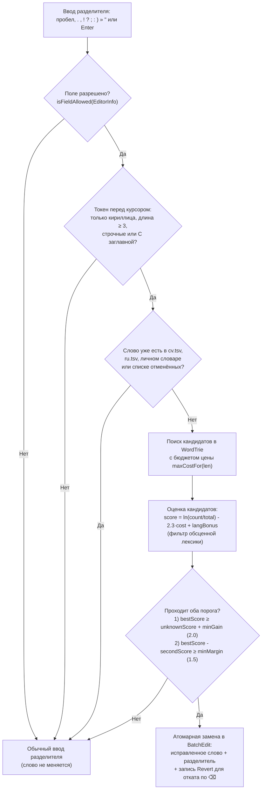

# Система автозамены опечаток (`data/autocorrect/`)

В этом документе подробно описана архитектура, алгоритмы, математическая модель, устройство словарей и правила работы экспериментальной функции **«Автозамена опечаток»** в клавиатуре **Кӗсье Тӳме** (задача [`T-013`](../tasks/specs/013-microdictionary.md)).

---

## 1. Ключевые принципы и ограничения

1. **Экспериментальный статус (выключена по умолчанию).**
   Настройка `experimentalAutocorrect = false` (ключ DataStore `exp_autocorrect_v1`) находится на вкладке **«Эксперименты»**. Пока тумблер выключен, словари не загружаются в оперативную память (`AutocorrectEngine.sync`).
2. **Без ленты подсказок.**
   В соответствии с дизайн-инвариантом № 3 (`AGENTS.md`), верхняя полоса клавиатуры остаётся однорядной (`36 dp`) без полосы кандидатов: автозамена работает автоматически при вводе разделителя и мгновенно откатывается одиночным нажатием `⌫`.
3. **Защита от перекрёстного искажения языков (`cv ⇄ ru`).**
   Если набранное слово присутствует **хотя бы в одном** из активных словарей (чувашском `cv.tsv`, русском `ru.tsv`) или в **личном словаре** пользователя, оно считается валидным словом и **никогда не исправляется**. Чувашское слово не может превратиться в русское даже при наборе на русской раскладке (и наоборот).
4. **100 % локально и приватно.**
   Словари встроены в `assets/dict/`, личный словарь хранится только на устройстве в `DataStore` (`personal_words_v1`), не пополняется в режиме инкогнито (`IME_FLAG_NO_PERSONALIZED_LEARNING`) и не затирается кнопкой «Сбросить все настройки».

---

## 2. Архитектура модулей

Исходный код расположен в пакете `src/app/src/main/java/org/chuvash/ktume/data/autocorrect/` и не зависит от Android UI:

| Файл | Роль |
|---|---|
| [`WordTrie.kt`](../src/app/src/main/java/org/chuvash/ktume/data/autocorrect/WordTrie.kt) | Компактное префиксное дерево в плоских примитивных массивах (`CharArray`, `IntArray`) и поиск кандидатов обходом в глубину (DFS) со взвешенным расстоянием Дамерау–Левенштейна |
| [`TypoCostModel.kt`](../src/app/src/main/java/org/chuvash/ktume/data/autocorrect/TypoCostModel.kt) | Модель стоимости правок: вычисляет соседство клавиш из рядов текущей раскладки (`fromRows`), задаёт дешёвую цену для диакритики (`ӑ ӗ ҫ ӳ`), похожих букв и сдвоенных нажатий, а также штраф первой буквы |
| [`Autocorrector.kt`](../src/app/src/main/java/org/chuvash/ktume/data/autocorrect/Autocorrector.kt) | Чистая функция принятия решения (`suggest`): фильтрация токена и регистра, проверка по всем словарям, ранжирование кандидатов, пороги уверенности (`minGain`, `minMargin`), фильтр обсценной лексики и политика полей (`isFieldAllowed`) |
| [`AutocorrectSession.kt`](../src/app/src/main/java/org/chuvash/ktume/data/autocorrect/AutocorrectSession.kt) | Состояние текущего поля ввода: хранит последнее автоисправление (`Revert`) для отката одним нажатием `⌫` и множество слов (`rejected`), отменённых пользователем в этом поле |
| [`AutocorrectEngine.kt`](../src/app/src/main/java/org/chuvash/ktume/data/autocorrect/AutocorrectEngine.kt) | Фоновый загрузчик словарей из `assets/dict/<lang>.tsv`, кэш таблиц соседства клавиш по языку и пресету, единая точка вызова `findCorrection` для `KesjeImeService` и тестового поля настроек |
| [`SettingsAutocorrect.kt`](../src/app/src/main/java/org/chuvash/ktume/ime/SettingsAutocorrect.kt) | Compose-компонент настроек на вкладке «Эксперименты»: тумблер, выбор языков (`Чӑвашла`, `Русский`), переключатель обучения и управление личным словарём |

---

## 3. Конвейер принятия решения (шаг за шагом)



### Шаг 1. Триггер-разделитель (`Autocorrector.isSeparator`)
Пока пользователь печатает буквы внутри слова, никакие замены не происходят. Проверка вызывается в трёх местах [`KesjeImeService`](../src/app/src/main/java/org/chuvash/ktume/ime/KesjeImeService.kt):
- в `onCommitText`, когда вводится одиночный символ из набора: пробел (`' '`), `.`, `,`, `!`, `?`, `;`, `:`, `)`, `»`, `"`;
- в `onReplaceSpaceWithComma` при двойном нажатии пробела (`", "`);
- в `onEnter`, когда клавиша `Enter` в многострочном поле работает в режиме `EnterKeyAction.NEWLINE` и вставляет `\n`.

### Шаг 2. Политика полей ввода (`Autocorrector.isFieldAllowed`)
Правила полностью соответствуют AOSP LatinIME:
- класс поля обязан быть `InputType.TYPE_CLASS_TEXT`;
- если поле является паролем (`isPasswordInputType`), не имеет нормального текстового типа (`TYPE_NULL`), либо имеет флаг `TYPE_TEXT_FLAG_NO_SUGGESTIONS` — автозамена **отключена**;
- если вариация поля — `TYPE_TEXT_VARIATION_URI`, `EMAIL_ADDRESS`, `WEB_EMAIL_ADDRESS`, `FILTER` или `VISIBLE_PASSWORD` — автозамена **отключена**;
- в **многострочных полях** (`TYPE_TEXT_FLAG_MULTI_LINE` — мессенджеры, заметки, посты) автозамена **разрешена по умолчанию**;
- в **однострочных полях** автозамена разрешена **только при наличии флага `TYPE_TEXT_FLAG_AUTO_CORRECT`** (поэтому в адресной строке браузера, большинстве поисковых строк и полях логина автозамена не вмешивается в запрос).

### Шаг 3. Извлечение и проверка слова (`extractCorrectableWord`, `classifyCase`)
Функция `extractCorrectableWord` берёт текст перед курсором на текущей строке (после последнего `\n`):
1. Выделяет непрерывный суффикс из букв (`Character.isLetter`).
2. Проверяет символ непосредственно перед словом: если там стоит цифра или один из технических символов (`@ # / _ . - + = : ~ % $ & *`), токен считается частью никнейма, хештега, пути, домена или составного слова и **не исправляется**.
3. Длина слова должна быть **не менее 3 букв** (`len >= 3`), и все буквы должны входить в чувашско-русский кириллический алфавит (`а–я, ё, ӑ, ӗ, ҫ, ӳ`).
4. Проверяется регистр (`classifyCase`):
   - `LOWER` (`превет`) → кандидат вернётся в нижнем регистре (`привет`);
   - `TITLE` (`Превет`) → кандидат вернётся с заглавной первой буквой (`Привет`);
   - `OTHER` (`ПРЕВЕТ`, `ПрЕвЕт`) → аббревиатуры и слова со смешанным регистром **не трогаются**.

### Шаг 4. Защита известных слов
Слово в нижнем регистре проверяется в следующем порядке:
1. В списке `rejected` текущей сессии поля (`AutocorrectSession`).
2. В личном словаре пользователя (`personalWords`).
3. Во **всех** загруженных словарях (`cv.tsv` и `ru.tsv` через `WordTrie.contains`).

Если слово найдено хотя бы в одном из этих источников — возвращается `null` (слово не меняется).

---

## 4. Префиксное дерево `WordTrie` и модель цен `TypoCostModel`

### 4.1. Устройство `WordTrie`
Чтобы оба словаря по `160 000` слов занимали минимум памяти и не создавали миллионы `Node`-объектов для сборщика мусора (GC), `WordTrie` хранит всё дерево в 4 плоских примитивных массивах:
- `chars: CharArray` — буква узла;
- `firstChild: IntArray` — индекс первого дочернего узла в тех же массивах (`-1`, если детей нет);
- `childCount: IntArray` — число детей узла (дети одного родителя лежат в массивах **подряд** и отсортированы по символу);
- `counts: IntArray` — частота слова в корпусе (`0` для промежуточных префиксов, не являющихся полным словом).

Кроме того, дерево хранит:
- `totalCount: Long` — сумму частот всех слов словаря (для расчёта относительной вероятности $P(w) = \text{count} / \text{totalCount}$);
- `minCount: Int` — минимальную частоту слова на границе отсечения словаря (`4` для `cv.tsv`, `17` для `ru.tsv`).

Сборка дерева из отсортированного по убыванию частоты TSV выполняется в один проход за ~70–90 мс в фоновом потоке `Dispatchers.IO`.

### 4.2. Модель цен правок (`TypoCostModel`)
При поиске в `WordTrie` используется целочисленная шкала цен:
- **`CHEAP = 1` («дешёвая» опечатка):**
  1. **Замена на соседнюю клавишу текущей раскладки (`fromRows`).** Соседство вычисляется автоматически по реальным рядам выбранной раскладки (с учётом горизонтального сдвига рядов): например, в `BALANCED_26` клавиши `ч` и `я` или `к` и `е` — соседи (`сегоднч → сегодня` стоит `1`).
  2. **Пропуск или путаница надстрочного знака и близких букв (`SIMILAR_GROUPS`):**
     - `а ↔ ӑ` (`чаваш → чӑваш`)
     - `е ↔ ӗ ↔ ё ↔ э` (`весем → вӗсем`, `пелмен → пӗлмен`)
     - `с ↔ ҫ` (`сак → ҫак`, `сире → ҫире`)
     - `у ↔ ӳ` (`туме → тӳме`)
     - `и ↔ й`, `ь ↔ ъ ↔ ы`, `ш ↔ щ`
  3. **Случайное удвоение или пропуск двойной буквы:** вставка или удаление второй одинаковой буквы подряд (`приввет → привет`, `росия → россия`).
- **`FULL = 2` (обычная правка):**
  - замена на далёкую клавишу (`превет → привет`);
  - пропуск или лишняя буква, не являющаяся дублем (`пожалйста → пожалуйста`);
  - перестановка двух соседних букв (`првиет → привет`).
- **Штраф за изменение первой буквы (`firstLetterExtra = +1`):**
  - при наборе на экранной клавиатуре пользователи значительно реже ошибаются в первой букве слова, чем в середине или конце. Поэтому любая замена, вставка, удаление или перестановка, затрагивающая позицию `0`, получает дополнительный штраф `+1` (кроме пар из `SIMILAR_GROUPS`, когда первая буква отличается только надстрочным знаком, например `сак → ҫак`).

### 4.3. Бюджет цены по длине слова (`Autocorrector.maxCostFor`)

| Длина набранного слова | Максимальная допустимая цена (`maxCost`) | Что разрешено |
|---|---|---|
| `3` буквы | **`1`** | Только 1 дешёвая правка (соседняя клавиша не на 1-й позиции, либо надстрочный знак `сак → ҫак`) |
| `4–5` букв | **`2`** | До 1 обычной правки (`FULL`) или до 2 дешёвых правок (`CHEAP`) |
| `6–8` букв | **`3`** | До 1 обычной + 1 дешёвой правки (или 3 дешёвых) |
| `9+` букв | **`4`** | До 2 обычных правок в длинном слове |

В процессе DFS-обхода дерева (`WordTrie.search`) для каждого узла поддерживается строка динамического программирования Дамерау–Левенштейна. Если минимальное значение во всей строке превышает `maxCost`, поддерево мгновенно отсекается. Поиск одного слова по обоим словарям (`320 000` словоформ суммарно) занимает в среднем **~0,5–2 мс**.

---

## 5. Ранжирование кандидатов и пороги (`Autocorrector.Tuning`)

Для каждого найденного в словарях кандидата (после отсева обсценной лексики функцией `isOffensive`) вычисляется логарифмическая оценка правдоподобия:

$$\text{score}(w) = \ln\left(\frac{\text{count}(w)}{\text{totalCount}}\right) - \text{costWeight} \cdot \text{cost}(w) + \text{langBonus}$$

Параметры по умолчанию (`Autocorrector.Tuning`), откалиброванные на выборке синтетических опечаток и редких словоформ вне словаря:

| Параметр | Значение | Смысл |
|---|---|---|
| `costWeight` | **`2.3`** | Каждая единица цены правки требует в $e^{2{,}3} \approx 10$ раз большей частоты кандидата (обычная правка `cost = 2` требует ~100-кратного перевеса по частоте над более близким кандидатом) |
| `activeLangBonus` | **`ln(10.0) ≈ 2.30`** | Прибавляется кандидатам из словаря текущей активной раскладки (`cv` на чувашской, `ru` на русской), чтобы при равной цене правки побеждал язык выбранной раскладки |
| `minGain` | **`2.0`** | Лучший кандидат обязан превзойти оценку «редкого неизвестного слова на границе словаря» ($\ln(\text{minCount}/\text{totalCount}) - 0{,}5 + \text{langBonus}$) минимум на `2.0`. Снижает долю ложных исправлений редких словоформ с ~60 % до **~2 %** |
| `minMargin` | **`1.5`** | Лучший кандидат обязан опережать второй по силе вариант минимум на `1.5` (перевес $\ge e^{1{,}5} \approx 4{,}5$ раза). Если два разных слова подходят почти одинаково хорошо — автозамена не рискует и оставляет исходное слово |

---

## 6. Откат первым `⌫` и личный словарь (`AutocorrectSession`)

1. **Как происходит замена:**
   Когда пользователь нажимает, например, пробел после слова `превет`, `KesjeImeService` внутри одного блока `beginBatchEdit()` / `endBatchEdit()`:
   - вызывает `deleteSurroundingText(6, 0)` (удаляет `превет`);
   - вызывает `commitText("привет ", 1)` (вставляет исправленное слово вместе с разделителем);
   - записывает в `autocorrectSession` объект `Revert(typed = "превет", corrected = "привет", separator = " ")`.
2. **Что делает одиночный `⌫` сразу после замены:**
   Если следующим действием пользователь нажимает `⌫`:
   - `autocorrectSession.consumeRevertOnBackspace()` возвращает сохранённый `Revert`;
   - клавиатура в одном `BatchEdit` удаляет `7` символов (`"привет "`) и вставляет `"превет "` — **разделитель (пробел или точка) остаётся на месте**, а слово возвращается к исходному виду;
   - слово `"превет"` добавляется в `autocorrectSession.rejected` (в текущем поле ввода оно больше не будет исправляться);
   - если включён тумблер **«Запоминать отменённые слова»** (`autocorrectLearnWords = true`) и поле не находится в режиме инкогнито (`Autocorrector.isLearningAllowed`), слово сохраняется в `PreferencesRepository.addPersonalWord("превет")`.
3. **Когда ожидание отката сбрасывается:**
   Любой следующий введённый символ, перемещение курсора, удаление слова свайпом или смена поля ввода сбрасывают `pending`-откат (`clearPending()`), и дальше `⌫` работает как обычное удаление одного символа.

---

## 7. Сборка словарей (`tools/dictionaries/build_dictionaries.py`)

Файлы [`src/app/src/main/assets/dict/cv.tsv`](../src/app/src/main/assets/dict/cv.tsv) и [`src/app/src/main/assets/dict/ru.tsv`](../src/app/src/main/assets/dict/ru.tsv) **не редактируются вручную** — они генерируются скриптом [`tools/dictionaries/build_dictionaries.py`](../tools/dictionaries/build_dictionaries.py).

### Источники и этапы очистки

1. **Чувашский словарь (`cv.tsv` — 160 000 словоформ, частота ≥ 4, ~3,2 МБ):**
   - **Источник частот:** корпус [`alexantonov/chuvash_mono`](https://huggingface.co/datasets/alexantonov/chuvash_mono) на Hugging Face (~3,14 млн предложений в двух Parquet-файлах, лицензия **`CC0-1.0`**).
   - **Нормализация:** все слова приводятся к нижнему регистру, оставляются только кириллические токены (`^[а-яёӑӗҫӳ]+$`), а «ложная латиница» (`ă ĕ ç ÿ ŭ`) внутри кириллических слов заменяется на `ӑ ӗ ҫ ӳ`.
   - **Очистка вариантов без диакритики (`drop_diacriticless_variants`):** в интернет-текстах часть авторов пишет по-чувашски русскими буквами без надстрочных знаков (*«весем»* вместо *«вӗсем»*, *«сак»* вместо *«ҫак»*). Если в корпусе вариант со знаками `ӑ ӗ ҫ ӳ` встречается в **≥ 30 раз чаще**, чем вариант без знаков, бездиакритический вариант удаляется из словаря (`21 201` форма). Благодаря этому автозамена автоматически проставляет чувашские буквы в таких словах.
   - **Фильтрация опечаток корпуса через Hunspell (`drop_corpus_typos`):** на этапе сборки скачивается орфографический словарь Николая Плотникова [`chuvash_spell_dictionary-1.13.xpi`](http://hunspell.chv.su/) (`cv_RU.aff` + `cv_RU.dic`). Если слово отвергается проверкой Hunspell **и** на расстоянии 1 правки от него есть слово в **≥ 20 раз частотнее**, такое слово признаётся опечаткой корпуса и удаляется (`98 216` форм). Сам словарь Hunspell в APK не включается.

2. **Русский словарь (`ru.tsv` — 160 000 словоформ, частота ≥ 17, ~3,2 МБ):**
   - **Источник частот:** проект [`hermitdave/FrequencyWords`](https://github.com/hermitdave/FrequencyWords), файл `content/2018/ru/ru_full.txt` (частоты по русским субтитрам OpenSubtitles 2018, лицензия **`CC BY-SA 4.0`**; атрибуция указана в [`THIRD_PARTY_NOTICES.md`](THIRD_PARTY_NOTICES.md)).
   - **Фильтрация опечаток субтитров через Hunspell (`drop_corpus_typos`):** в сырых субтитрах частые опечатки вроде *«пожалйста»* (40 раз) или *«здраствуйте»* (318 раз) присутствуют в списке и без фильтрации блокировали бы собственное исправление. Проверка через словарь Hunspell `ru_RU` из репозитория LibreOffice удаляет все слова, отвергнутые Hunspell и имеющие соседа в 1 правке в ≥ 20 раз частотнее (`173 990` опечаток), сохраняя при этом настоящие короткие и редкие слова (*«танк»*, *«тесть»*, *«меняю»*).

### Как пересобрать словари локально

Исходные файлы скачиваются один раз в `tools/dictionaries/.cache/` (папка добавлена в `.gitignore`):

```powershell
python -m pip install pyarrow spylls
python tools/dictionaries/build_dictionaries.py
```

---

## 8. Тестирование и калибровка порогов

Автозамена покрыта двумя наборами unit-тестов (`src/app/src/test/java/org/chuvash/ktume/data/autocorrect/`):

1. **[`AutocorrectorTest.kt`](../src/app/src/test/java/org/chuvash/ktume/data/autocorrect/AutocorrectorTest.kt) (15 тестов):**
   - точность структуры `WordTrie` и всех 4 видов правок Дамерау–Левенштейна;
   - приоритет соседних клавиш раскладки и чувашских надстрочных знаков (`TypoCostModel`);
   - сохранение регистра (`превет → привет`, `Превет → Привет`, `ПРЕВЕТ → null`);
   - неприкосновенность известных слов чувашского, русского и личного словарей;
   - работа порога `minGain` против редких кандидатов;
   - фильтр обсценной лексики, политика полей `isFieldAllowed` и сессия отката `AutocorrectSession`.
2. **[`AutocorrectDictionaryTest.kt`](../src/app/src/test/java/org/chuvash/ktume/data/autocorrect/AutocorrectDictionaryTest.kt) (7 тестов на реальных `cv.tsv` и `ru.tsv`):**
   - исправление реальных русских и чувашских опечаток;
   - проверка, что тысячи частых чувашских и русских слов никогда не искажаются при наборе на любой раскладке;
   - замер скорости поиска (укладывается в бюджет времени реального ввода);
   - оценка доли ложных срабатываний на отложенной выборке редких форм (`cv_holdout.tsv`, `ru_holdout.tsv`);
   - сетка калибровки параметров `reportTuningGrid` (запускается при установленной переменной окружения `KTUME_TUNING=1`).
